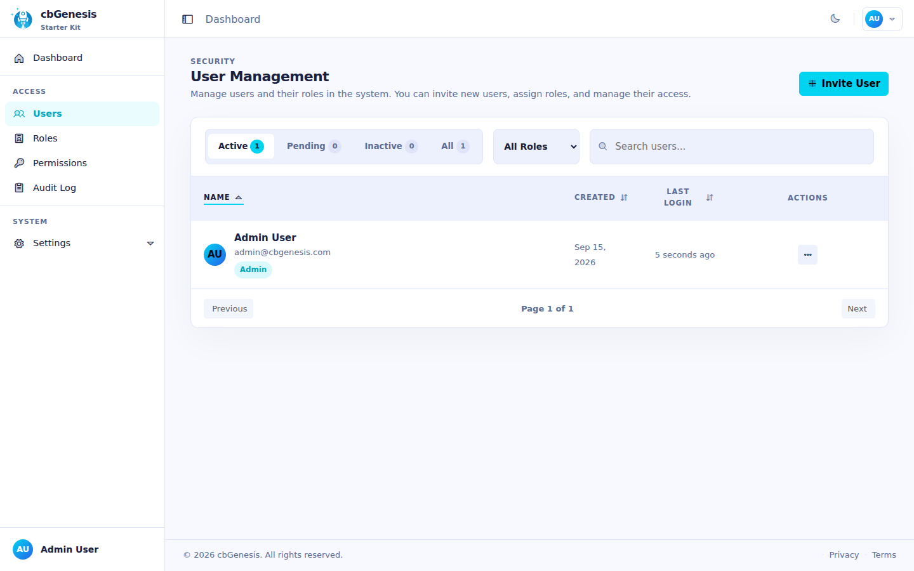

# Handlers & Routing

## Handler map

| Handler | Base | Purpose |
|---|---|---|
| [`AuditLog.bx`](#auditlog) | `BaseSecureHandler` | Audit trail browsing, export, and purging |
| [`Assets.bx`](#assets) | `EventHandler` | Streams user avatars and the branding logo |
| [`Auth.bx`](#auth) | `EventHandler` | Login, registration, invitations, password reset - all public |
| [`BaseSecureHandler.bx`](#basesecurehandler) | `RestHandler` | Base class for every admin handler |
| [`Dashboard.bx`](#dashboard) | `BaseSecureHandler` | The authenticated landing page |
| `Main.bx` | `EventHandler` | Implicit-event handler - see [Architecture](../architecture.md#request-lifecycle) |
| [`Permissions.bx`](#permissions) | `BaseSecureHandler` | Permission slug CRUD |
| [`Profile.bx`](#profile) | `BaseSecureHandler` | Self-service profile, password, API tokens, passkeys |
| [`Roles.bx`](#roles) | `BaseSecureHandler` | Role CRUD + user assignment |
| [`Settings.bx`](#settings) | `BaseSecureHandler` | App settings registry |
| [`Users.bx`](#users) | `BaseSecureHandler` | User administration |

### `BaseSecureHandler`

Every protected handler extends `BaseSecureHandler`, whose `preHandler` forces the `Admin` layout, and redirects to `profile/passkey-required` when `cbRequirePasskey` is on and the user has none. It also provides shared helpers (`getApiResults()`, `ensureSortDirection()`, `getPagination()`):

```boxlang title="app/handlers/BaseSecureHandler.bx" linenums="1"
component extends="coldbox.system.RestHandler" {

    function preHandler( event, rc, prc ){
        event.setLayout( "Admin" );
        // ...passkey enforcement...
    }

}
```

Building a new secured handler starts the same way every time:

```boxlang title="Example: a new secured handler" linenums="1"
component extends="BaseSecureHandler" secured {

    function index( event, rc, prc ){
        prc.pageTitle = "My Page";
        event.setView( "myhandler/index" );
    }

}
```

### `AuditLog`

`@secured("auditlog:admin,auditlog:read")` at the class level; every action but `index` is `@remote`:

- `index`, `search`, `show` - browse and filter the audit trail
- `export` - `@secured("auditlog:admin,auditlog:export")`, streams CSV
- `purge` - `@secured("auditlog:admin,auditlog:delete")`, deletes entries older than a cutoff
- `clear` - `@secured("auditlog:admin")`, deletes every entry

### `Assets`

No `@secured` annotation at the class level - it streams binary files from the private cbfs `assets` disk (see [Database & ORM](database-orm.md) and `app/config/modules/cbfs.bx`), which sits outside the webroot and is otherwise unreachable:

- `avatar` - `@secured` (any authenticated user), streams a user's `sm`/`lg` avatar JPEG variant
- `logo` - public, streams the `sm`/`lg` branding logo PNG variant so the login screen and other guest pages can render it

Both actions 404 (rather than erroring) for an unrecognized `userId`/`size` shape or when the requested file simply does not exist, so a caller cannot distinguish "no avatar" from "no such user" by response shape alone. Resizing, cropping, and storage go through `ImageService` (`app/models/system/ImageService.bx`), invoked via `getInstance()` inside each action rather than an `@inject` property - see the docblock on `Assets.bx` for why (a WireBox boot-order quirk with handler-triggered singleton construction).

### `Auth`

No `@secured` annotation - these actions must stay reachable by guests:

- `login` / `doLogin` (GET/POST) - CSRF-verified, calls `securityService.login()`, supports `rememberMe`
- `register` / `doRegister` - gated by the `cbAllowRegistration` setting
- `checkEmailAvailability` - JSON endpoint for live email-availability checks
- `verifyRegistration` - consumes a `PURPOSE_REGISTRATION` action token
- `activateInvitation` / `doActivateInvitation` - sets a password for an invited, admin-created user
- `forgotPassword` / `doForgotPassword` - gated by `cbAllowForgotPassword`
- `resetPassword` / `doResetPassword` - validates the reset token, sets a new password
- `verifyEmailChange` - consumes a `PURPOSE_EMAIL_CHANGE` action token
- `logout` - calls `securityService.logout()`

`preHandler` redirects an already-authenticated visitor straight to the dashboard, and sets the layout from `prc.settings.cbLoginLayout` (`AuthSplit` by default - see [`guides/security.md`](security.md)); `verifyEmailChange` and `logout` are exempted from that redirect so they stay reachable whether or not the visitor is already authenticated.

### `Dashboard`

`@secured` (any authenticated user, no specific permission required):

- `index` - the dashboard home
- `notAuthorized` - the target of `invalidAuthorizationEvent`, shown when an authenticated user is missing a required permission

### `Permissions`

`@secured("permissions:admin,permissions:read")` at the class level:

- `index`
- `create` - `@secured("permissions:admin,permissions:write")`
- `update` / `delete` - `@remote`, same write/delete permissions

### `Profile`

`@secured` self-service actions for the current user, all `@remote` AJAX endpoints except `index`:

- `index`, `passkeyRequired`
- `save`, `doPasswordChange`
- `requestEmailChange` / `cancelEmailChange` - starts/cancels a pending email change, confirmed via `Auth.verifyEmailChange`
- `listTokens` / `createToken` / `updateToken` / `deleteToken` - API tokens
- `listPasskeys` / `updatePasskey` / `deletePasskey`
- `uploadAvatar` / `deleteAvatar` - accepts the image as a base64 data URI in `rc.avatar` (BoxLang has no multipart/form-data parser, so uploads travel as JSON), decoded via `BaseSecureHandler.decodeDataUri()`; streamed back by `Assets.avatar`

Every one of these is CSRF-verified by the `csrf` route middleware unless it is reached over a safe HTTP method - see [CSRF verification](#csrf-verification).

### `Roles`

`@secured("roles:admin,roles:read")` at the class level; every action but `index` is `@remote`:

- `index`
- `create` / `update` / `delete` - `@secured("roles:admin,roles:write"` / `"...:delete")`
- `users` / `availableUsers` - list users on/available for a role
- `addUser` / `removeUser` - `@secured("roles:admin")`

### `Settings`

`@secured("settings:admin,settings:read")` at the class level:

- `index`
- `registry` / `registrySearch` - paginated settings registry
- `createRegistry` / `updateRegistry` / `toggleRegistryStatus` / `deleteRegistry` - `settings:admin,settings:write`
- `save` - bulk save of core settings
- `uploadLogo` / `deleteLogo` - `settings:admin,settings:write`, same base64 data URI convention as `Profile.uploadAvatar`; stores/restores the `cbAppLogo` setting and streams back via `Assets.logo`
- Admin utilities (all `settings:admin`): `clearTemplateCache`, `clearSessionsCache`, `revokeRememberTokens`, `flushSettingsCache`

### `Users`

`@secured("users:admin,users:read")` at the class level:

- `index`, `search`
- `create` / `update` / `delete` / `resendInvitation` - `users:admin,users:write` / `...:delete`
- `show` - `users:read`
- Admin-only (`users:admin`): `updateProfile`, `setStatus`, `resetPassword`, `verify`, `revokeRememberTokens`, `addRole`/`removeRole`, `addPermission`/`removePermission`, `savePreferences`, `revokeToken`/`revokeAllTokens`

`ensureNotSelf()` guards several of these to block an admin from demoting or removing their own roles.

<figure>
	
	<figcaption>The Users admin page.</figcaption>
</figure>

## CSRF verification

`app/config/modules/cbsecurity.bx` sets `csrf.enableAutoVerifier: false`, so there is no global interceptor. Instead, state-changing requests are verified **deny-by-default by route middleware**. `app/middleware/AppVerifyCsrf.bx` extends cbsecurity's `VerifyCsrf`, and `app/config/Router.bx` attaches it by name to the whole secured route group and to the conventions-based catch-all:

```boxlang title="app/config/Router.bx (excerpt)" linenums="1"
registerMiddleware( {
    csrf    : "AppVerifyCsrf",
    throttle: "AppThrottle",
    honeypot: "Honeypot@cbsecurity"
} )

group( { middleware: [ "csrf" ] }, () => {
    // dashboard, permissions, roles, users, auditlog, profile, settings, assets
} )

route( ":handler/:action?" ).middleware( "csrf" ).end()
```

What this means when you add a route:

- **Put it in the `csrf` group.** Any request over `POST`, `PUT`, `PATCH`, or `DELETE` must carry a valid `rc.csrf` (or an `x-csrf-token` header). A route declared outside the group is not verified. `RouteMiddlewareTest` fails if a state-changing route lacks the middleware.
- **Safe methods are exempt.** `GET`, `HEAD`, and `OPTIONS` must not change state, so they carry no CSRF risk, and `OPTIONS` (CORS preflight) cannot carry a token at all. If a safe method in your code does change state, that is the bug to fix.
- **A failure is a JSON 403 by default.** That is what the JSON/AJAX endpoints want: they submit through `fetchWithCsrf()` (see [Frontend](frontend.md#csrf-on-mutating-requests)), which recovers from a stale token instead of needing a redirect. A route that serves a native HTML form post opts into a flash message and redirect with `.meta( { csrfRedirect: "settings" } )`, as the `Settings` form routes do.
- **Middleware only runs for routed requests.** `execute( "handler.action" )` bypasses it. To test a CSRF failure, use `post( route = "/path" )` (ColdBox 8.3+) or call the middleware directly, as `RouteMiddlewareTest` does.

!!! note "`Auth` verifies its own token"
    `Auth` extends `coldbox.system.EventHandler`, not `BaseSecureHandler`, because its actions run for unauthenticated visitors. Its routes sit outside the `csrf` group and each state-changing action verifies its own token: `doLogin`, `doRegister`, `doActivateInvitation`, `doForgotPassword`, `doResetPassword`, and `logout`.

## Route map (`app/config/Router.bx`)

All routes are declared in one `configure()` function:

```boxlang title="app/config/Router.bx (excerpt)" linenums="1"
route( "/healthcheck" ).to( () => "Ok!" );

get( "dashboard" ).to( "Dashboard.index" );

resources( "permissions", parameterName = "permissionId" );

route( "roles/:roleId/available-users" ).to( "Roles.availableUsers" );
route( "roles/:roleId/users" ).toAction( { POST: "addUser" } );
route( "roles/:roleId/users/:userId" ).toAction( { DELETE: "removeUser" } );
resources( "roles", parameterName = "roleId" );

resources( "users", parameterName = "userId" );

route( "profile" ).toAction( { GET: "index", POST: "save" } );

// @app_routes@  ← insertion point for module/scaffold-generated routes

route( ":handler/:action?" ).end(); // conventions-based catch-all
```

See [Reference: Route Map](../reference/routes.md) for the full table of every method, URL, target action, and required permission.

::: cards
::: card title="Route Map" icon="phosphor-duotone:map-trifold" href="../reference/routes.md"
The complete method/URL/handler/permission table.
:::
::: card title="Security & Permissions" icon="phosphor-duotone:shield-check" href="security.md"
How `@secured` ties into the firewall and the permission model.
:::
::: card title="Extending the App" icon="phosphor-duotone:puzzle-piece" href="extending.md"
Add a new handler, route, and view following these same conventions.
:::
:::
