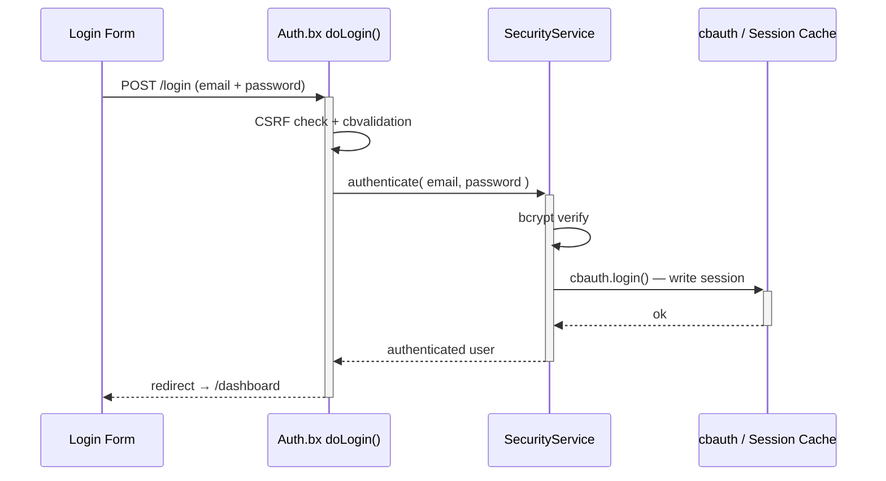
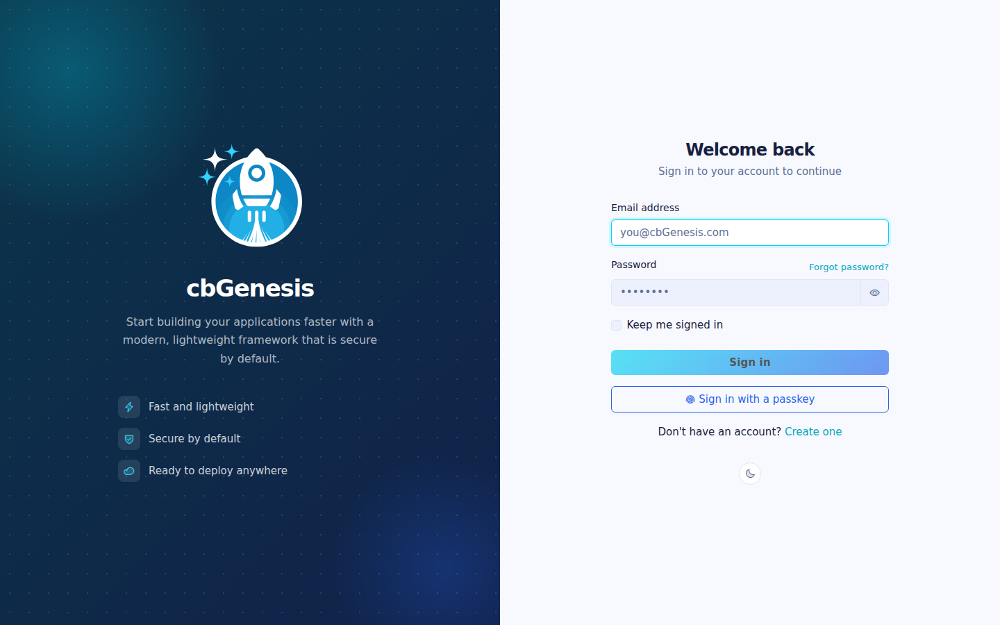
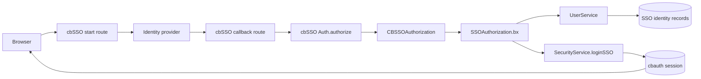
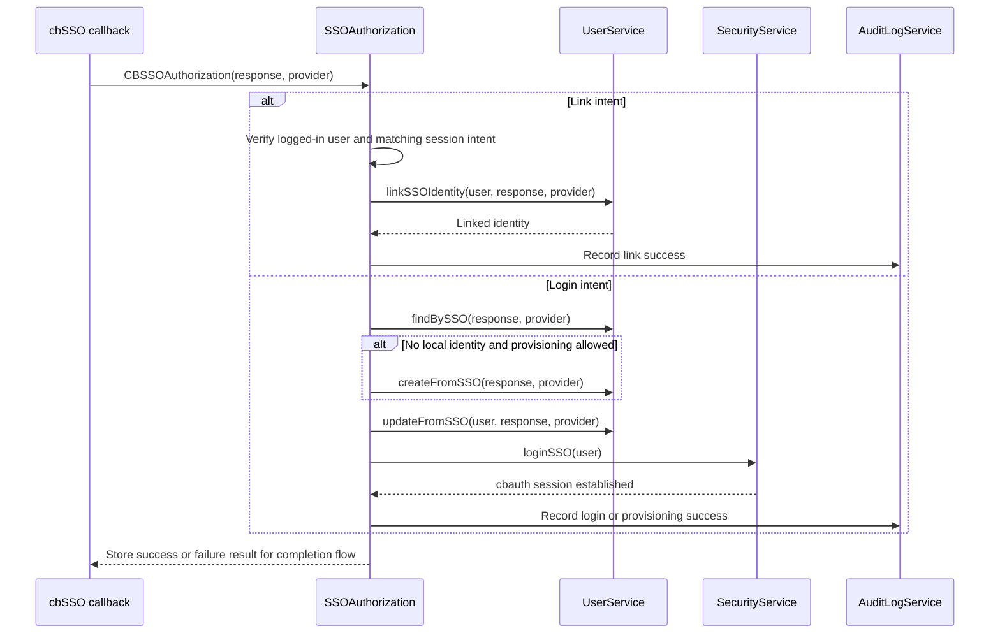
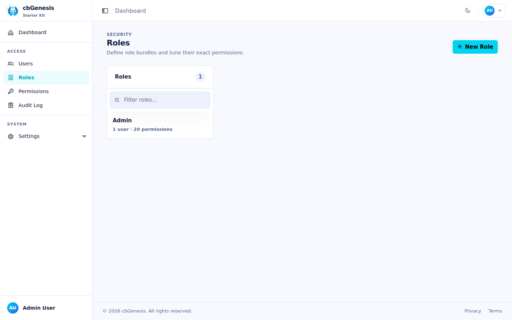
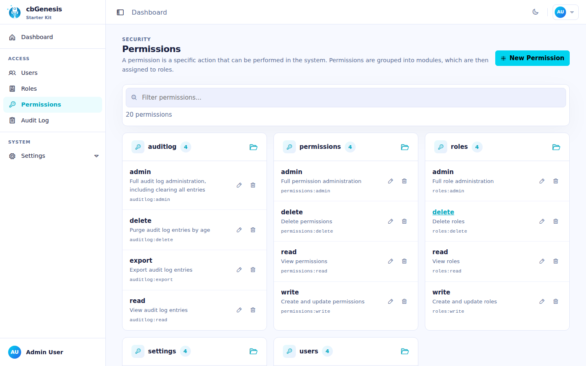
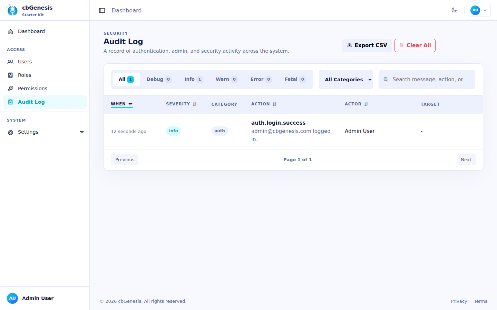

# Security & Permissions

## Login flow



## Authentication layouts

The authentication flow can use either shipped layout through the `cbLoginLayout` setting:

| Value | Layout | Best for |
|---|---|---|
| `AuthSplit` | Branded feature panel on the left with the form on the right; it becomes compact on mobile. | Applications that want a branded, two-panel sign-in experience. This is the default. |
| `AuthCenter` | Centered authentication card with the logo, form, and footer. | Applications that prefer a focused, compact sign-in experience. |

Choose **Auth Center** or **Auth Split** on the `/settings` page. The selected layout applies to login, registration, invitation activation, and password-recovery pages. See [App Settings](../reference/settings.md#login-layout-selection) for the layout files and custom-layout instructions.

<figure>
	
	<figcaption>The login screen using the default <code>AuthSplit</code> layout.</figcaption>
</figure>

## Single sign-on

cbSSO is enabled through `app/config/modules/cbsso.bx`. It uses cbauth as the
session authority, so local password login, passkeys, and SSO share the same
session and authorization rules. The login page renders a link for every
configured provider.

Google is the shipped example provider. Set these values in `.env` after
registering the callback URL `/cbsso/auth/Google` with Google:

```dotenv linenums="1"
GOOGLE_CLIENT_ID=
GOOGLE_CLIENT_SECRET=
GOOGLE_REDIRECT_URI=https://example.com/cbsso/auth/Google
```

### Enabling and disabling SSO

There is no separate `SSO_ENABLED` setting. The effective provider switch is in
[`app/config/modules/cbsso.bx`](../../app/config/modules/cbsso.bx): cbGenesis
registers Google only when `GOOGLE_CLIENT_ID`, `GOOGLE_CLIENT_SECRET`, and
`GOOGLE_REDIRECT_URI` are all populated. To disable Google SSO, clear any one of
those values and restart or reinitialize the application. The provider will no
longer appear on the login or profile pages.

Do not confuse this with `enableCBAuthIntegration: false`. That setting disables
cbSSO's optional generic cbauth listener; cbGenesis uses its own
`SSOAuthorization` interceptor so it can enforce local account-linking,
provisioning, identity-matching, and audit rules. See cbSSO's documentation for
[configuration](https://cbsso.ortusbooks.com/),
[identity-provider response handling](https://cbsso.ortusbooks.com/usage/handling-the-identity-provider-response.md),
[interception points](https://cbsso.ortusbooks.com/usage/interception-points.md),
and [cbauth integration](https://cbsso.ortusbooks.com/cbauth-integration/enabling-integration.md).

::: stepper
::: step "Prepare the database"
From the project root, run the SSO identity migration:

```bash linenums="1"
box migrate up
```

This creates the `user_sso_identities` table used to link a local account to an
identity-provider subject. Run this before attempting the first SSO login.
:::

::: step "Create and configure the Google OAuth client"
In [Google Cloud Console](https://console.cloud.google.com/), create or select
a project, configure the OAuth consent screen, and create an **OAuth client ID**
with application type **Web application**. Add this exact authorized redirect
URI, using the public HTTPS URL of your app:

```text linenums="1"
https://your-domain.example/cbsso/auth/Google
```

Copy the client ID and client secret into the local `.env` file. The redirect
URI must be the same value in Google Cloud and `GOOGLE_REDIRECT_URI`:

```dotenv linenums="1"
GOOGLE_CLIENT_ID=your-google-client-id
GOOGLE_CLIENT_SECRET=your-google-client-secret
GOOGLE_REDIRECT_URI=https://your-domain.example/cbsso/auth/Google
```

Keep credentials out of source control. cbGenesis registers the Google provider
only when all three `GOOGLE_*` settings are populated, so the application can
still boot before SSO is configured.

Automatic account creation is disabled by default. To allow new Google users,
explicitly enable it and restrict the permitted email domains:

```dotenv linenums="1"
CBSSO_AUTO_PROVISION=true
CBSSO_ALLOWED_DOMAINS=example.com,example.org
```

Leave `CBSSO_AUTO_PROVISION=false` when every SSO user must already have a local
account. Those users must sign in locally and use the profile's **Link Google
account** action before they can sign in with Google.
:::

::: step "Start the app and verify the flow"
Start the application with your normal development or deployment command, then
open `/login` and select **Continue with Google**. Confirm that Google redirects
back to `/cbsso/auth/Google` and that the application sends you to the dashboard.

For an existing local account, first sign in with the password, open the profile
page, and link the Google account. Sign out, return to `/login`, and verify that
Google SSO signs you back into the same local account. If provisioning is
enabled, verify that a permitted domain creates a local user and that a domain
outside `CBSSO_ALLOWED_DOMAINS` is rejected.
:::
:::

After setup, identities are matched by provider and immutable subject, never by
email alone. Existing local accounts must be explicitly linked before they can
be used through SSO.

For clustered SAML deployments, configure cbSSO's `samlRequestCacheName` to a
distributed CacheBox region instead of using the default in-memory replay cache.

### How cbSSO becomes a local session

cbSSO owns the provider protocol and callback validation. cbGenesis owns the
decision that follows: which local account the verified identity belongs to,
whether it may be provisioned or linked, and how it becomes an authenticated
application session.



The application registers `app/interceptors/SSOAuthorization.bx` for cbSSO's
documented `CBSSOAuthorization` interception point. The callback payload
contains the verified provider response and the provider that handled it. The
interceptor then follows one of two application-owned paths:



### Why this interceptor exists

cbSSO also provides a generic `cbAuth` integration listener. cbGenesis
intentionally sets `enableCBAuthIntegration: false` in
`app/config/modules/cbsso.bx`, because the generic listener cannot enforce the
application's identity and account-security rules. The custom interceptor is
responsible for:

- Matching identities by provider and immutable subject, never by email alone.
- Requiring an authenticated session and matching intent for account linking.
- Applying the provisioning and allowed-domain policy before creating users.
- Keeping local password, remember-me, passkey, and SSO authentication paths
  under the same cbauth session authority.
- Recording successful and failed SSO operations in the audit trail.

This separation is deliberate: cbSSO verifies *who the provider says the user
is*; cbGenesis decides *what that identity is allowed to do in this application*.

For the upstream contract and the alternative generic integration, see the
[cbSSO interception points](https://cbsso.ortusbooks.com/usage/interception-points.md),
[identity-provider response handling](https://cbsso.ortusbooks.com/usage/handling-the-identity-provider-response.md),
and [cbAuth integration](https://cbsso.ortusbooks.com/cbauth-integration/enabling-integration.md)
documentation.

## Security layers

| Layer | Implementation |
|---|---|
| Session auth | cbauth with `CacheStorage@cbStorages` — server-side session cache |
| Password hashing | bcrypt via `bx-password-encrypt` |
| Password policy | `SettingService.isValidPassword()` — `cbMinPasswordLength` plus an uppercase letter, a lowercase letter, a digit, and a special character. Enforced server-side on registration, invitation activation, password reset, and profile password change; the Alpine `$passwordMeetsPolicy` helper mirrors it in the browser |
| CSRF protection | cbsecurity rotating token (30 min); the auto-verifier is off, and `BaseSecureHandler` verifies deny-by-default on every unsafe HTTP method instead — see [Handlers & Routing](handlers-routing.md#csrf-verification) |
| Handler security | `@secured` annotation → firewall redirects unauthenticated visitors to `login`, authorized-but-unpermitted users to `dashboard.notAuthorized` |
| JWT support | Configured for API access (HS512, 60 min, cache token storage) |
| Security headers | XSS protection, `frameOptions: SAMEORIGIN`, `referrerPolicy: same-origin` |
| API tokens | SHA/BCrypt-hashed per-user tokens with expiration and a daily purge scheduler |
| Bot trap | `Honeypot@cbsecurity` route middleware on the register form: a hidden `website_url` field only bots fill in. A filled field is answered with a silent `200 OK` and the handler never runs. It is attached to the single `register` route in `app/config/Router.bx` |
| Rate limiting | `AppThrottle` route middleware limits login, registration, and password reset by IP - see [Rate limiting](#rate-limiting) below |

## Rate limiting

`app/middleware/AppThrottle.bx` extends cbsecurity's `Throttle` route middleware. `app/config/Router.bx` attaches it by its WireBox ID (`AppThrottle`) to five unauthenticated `Auth` routes and two `Profile` SSO routes, limiting by client IP:

- `login`, `register`, `activate-invitation`, `forgot-password`, `reset-password` (their `doLogin`, `doRegister`, `doActivateInvitation`, `doForgotPassword` and `doResetPassword` submits)
- `profile/sso/:provider/start` (a `GET`) and `profile/sso/:provider` (the `DELETE` that unlinks)
- `auth/doLogin`, `auth/doRegister`, `auth/doActivateInvitation`, `auth/doForgotPassword` and `auth/doResetPassword`: the conventions-based catch-all route exposes every `Auth` action at `auth/<action>`, so a direct post to those URLs would skip the middleware above. They have their own routes with the same middleware and meta, and because the counter is named after the event, they share one budget with the named route.

Each form page and its submit are **one route**. ColdBox merges routes that share a pattern and keeps only the first one's middleware, so splitting them into a `get` and a `post` route silently drops the throttle. Instead `AppThrottle` counts only the methods the route names in its `throttleMethods` meta, by default `POST`, `PUT`, `PATCH` and `DELETE`, so loading a form never counts as an attempt. The SSO start route sets `throttleMethods: "GET"`.

A blocked HTML form post is redirected back to the form with a flash error (the route's `throttleRedirect` meta, plus `throttleTokenParam` where the form needs its token back). Any other caller gets cbsecurity's JSON `429` with a `Retry-After` header. Either way the request never reaches the handler, so a correct password submitted while blocked still does not log the user in.

The cbSSO callback is a route owned by the cbsso module, so application middleware cannot be attached to it. `app/interceptors/SSORateLimiter.bx` throttles that one endpoint with the same limits.

| Setting | Purpose |
|---|---|
| `cbRateLimitMaxAttempts` | Attempts allowed per IP, per endpoint, within the window (default: `5`) |
| `cbRateLimitWindowSeconds` | Window length, in seconds (default: `300`). `0` disables rate limiting entirely |
| `cbTrustProxyHeaders` | Whether the "per IP" in "per IP, per endpoint" comes from `X-Forwarded-For` or the raw socket address (default: `true`) - see [Deploying behind a reverse proxy](../deployment.md#deploying-behind-a-reverse-proxy) |

All three are editable at `/settings` like any other app setting - see [App Settings](../reference/settings.md#password--token-policy).

!!! warning "`cbTrustProxyHeaders` is a deployment decision, not a code decision"
    `X-Forwarded-For` is a plain HTTP header - any caller can set it to anything unless something in front of the app (a reverse proxy or load balancer) strips whatever the client sent and sets it itself. Whether that's true is something only the person deploying the app knows.

    - **On (default)**: trusts `X-Forwarded-For`/`X-Cluster-Client-IP`, matching a typical deployment of this app behind a reverse proxy or load balancer. If your proxy does *not* overwrite that header (or you're directly internet-facing with nothing in front of the app), a caller can spoof it to get a fresh rate-limit bucket on every request and to fake the IP recorded in the audit trail - turn this off in that case.
    - **Off**: `getRealIP()` uses the raw socket address instead. Correct when the app is directly internet-facing, but if you *are* behind a proxy, every caller looks like the proxy's own IP - one blocked "IP" blocks everyone behind it, and every audit log entry shows the proxy's address instead of the real client's.

### How counting works

cbsecurity's `RateLimiter` counts in a **fixed window**: a key's window starts with its first attempt and ends `cbRateLimitWindowSeconds` later, whatever happens in between. Blocked requests do not extend it, so `Retry-After` is accurate. `AppThrottle` records each attempt before deciding (using the count `RateLimiter.hit()` returns under its lock), so a burst of simultaneous requests cannot overshoot the limit.

Only the first blocked request of each window is written to the audit trail (`security.ratelimit.blocked`), once per endpoint and IP. Further blocked requests are not audited, so an attacker cannot grow the audit table at the rate they can send requests; use the web server's access log to see them all. (The previous in-house limiter was a sliding window that restarted on every attempt.) Each endpoint has its own counter (keyed by event and IP), so exhausting the login limit does not affect registration or password reset.

!!! note "In-memory by default"
    Counters live in the `rateLimit` CacheBox region (`app/config/CacheBox.bx`), which is in-memory and therefore **per application instance**. Behind a load balancer with more than one instance, each instance enforces its own limit independently - a caller could get `cbRateLimitMaxAttempts` free attempts per instance rather than in total. To share counts across instances, swap the `rateLimit` region's `provider`/`properties` for a distributed CacheBox provider (Redis, Couchbase, or any provider CacheBox supports) - no code change needed, since `AppThrottle` and `SSORateLimiter` both count in the `rateLimit` region.

### History

Every blocked request is counted, so the admin page can show top offenders and a history chart, without a database write per request, which an attacker could otherwise drive. `RateLimitHistoryService` keeps it bounded at each step:

1. **Tally.** A blocked request adds to an in-memory tally keyed by hour, IP and endpoint. This is a map update, never a database call. The tally holds at most 2,000 keys; further IPs add to a shared `other` entry.
2. **Flush.** A scheduled task writes each server's tally to `rate_limit_history` every minute, adding to the row for that hour, IP and endpoint. An hour keeps at most 500 rows; further IPs add to that hour's `other` row. The task runs on every server (each has its own tally), and the unique key makes concurrent flushes safe. A failed flush puts its tally back and tries again, so a database outage loses nothing and cannot grow the tally past its cap. A server that stops loses at most the last minute.
3. **Purge.** A daily task deletes rows older than `cbRateLimitHistoryRetentionDays` (default 30).

The audit log is separate: one row per blocked window, for security review. History rows are hourly totals: `blockedRequests` (every blocked request), `blockedWindows` (the first block of each window, matching the audit rows) and `peakAttempts`. The service also answers `topOffenders()`, `hourly()` and `latest()` for the admin page.

### Blocked IPs

An address or range on the block list is refused on its first request: `RateLimitBlocker` (an interceptor registered ahead of the others, on `preProcess`) answers `403 Forbidden` before routing, the handler or the database run, and the throttle skips the request. Blocks come from two places:

- **An admin adds one.** `POST /ratelimiting/blocks` with `address` (an address such as `203.0.113.42`, or a CIDR range such as `203.0.113.0/24`, IPv4 or IPv6), `hours` (1 to 8760, or `0` for permanent) and an optional `reason`. `GET /ratelimiting/blocks` lists the active ones and `DELETE /ratelimiting/blocks/:blockId` removes one. They need the `settings:admin` permission, and the writes a CSRF token. A bad address, a range wider than IPv4 `/16` or IPv6 `/48`, and an address that includes the admin's own are refused with a 422 saying why. Host names are never accepted or looked up. The list holds at most 1,000 active blocks.
- **The automatic rule adds one.** When an IP has been throttled in `cbRateLimitAutoBlockWindows` windows (default 3) within `cbRateLimitAutoBlockPeriodMinutes` (default 60), it is blocked for `cbRateLimitAutoBlockHours` (default 24). `cbRateLimitAutoBlock` switches the rule off. Loopback, private (`10/8`, `172.16/12`, `192.168/16`), link-local and shared (`100.64/10`) addresses are never blocked automatically, because with proxy headers untrusted they can be the proxy or the server itself and so stand for everyone. If the app sits behind a proxy and `cbTrustProxyHeaders` is off, every caller looks like the proxy: that is why those addresses are skipped.

The check is cheap because it never queries the database. It reads an in-memory snapshot of the active blocks, reloaded at most every 30 seconds and at once after this server changes the list. Another server therefore notices a new block within 30 seconds. If a reload fails, the previous snapshot stays in use, and a broken check lets the request through instead of failing it.

A pause from the admin page does **not** switch the block list off: pausing only skips the attempt limits. The `RATE_LIMITING_ENABLED` environment variable is the full break-glass and does switch it off, so a wrong block can never keep an admin out. Each refused request is tallied in the history under the endpoint `Blocked IP`, never written to the audit log; adding, removing and automatically adding a block are audited (`security.ratelimit.ip_blocked`, `ip_unblocked`, `ip_autoblocked`). Expired blocks are ignored at once and deleted daily.

### Admin page and endpoints

The admin page is at **System > Rate Limiting** (`/ratelimiting`, needs `settings:read`). It has four tabs: Overview (top offenders, hourly history, live counters you can clear, latest blocks), Blocked IPs, Exclusions and Settings, plus the pause control. While rate limiting is paused, every other admin page shows a red strip so a pause is not forgotten. The page is built on these endpoints, all under `/ratelimiting`:

| Request | Permission | What it does |
|---|---|---|
| `GET overview?hours=24&latest=25` | `settings:read` | Status, live counters, top offenders, hourly history, latest history rows and totals in one call. `hours` is 1 to 168, `latest` 1 to 100. |
| `GET counters?max=25` | `settings:read` | The live attempt counters, busiest first, at most 100 rows, with the total and how many are throttled. |
| `DELETE counters/:counterKey` | `settings:admin` | Clears one counter (`<event>:<ip>`, URL encoded) so that client starts a fresh window. 404 when it has expired. |
| `DELETE counters` | `settings:admin` | Clears every counter. |
| `GET settings` | `settings:read` | The rate limiting settings. |
| `PUT settings` | `settings:admin` and `settings:write` | Saves the rate limiting settings. Other keys are ignored and a bad value is a 422 naming the field. |

Clearing counters only resets the attempt windows: the block list, the exclusions and the history are not touched. Both clears are audited (`security.ratelimit.counter.cleared`, `security.ratelimit.counters.cleared`), and so are settings changes (`security.ratelimit.settings.updated`). The cache store lower-cases its keys, so endpoints appear in lower case, for example `auth.login`.

### Exclusions

Some callers should never be held to the attempt limits: an office VPN, an uptime monitor, a service account. An exclusion says so, for an IP address, a CIDR range or a user.

- **IP and range exclusions** skip `AppThrottle` and `SSORateLimiter`, are never blocked automatically, and cannot be blocked by hand (the block is refused with a 422 if it overlaps an exclusion). If an excluded address is on the block list anyway, for example because it was blocked first, the exclusion wins and the request is let through. A range may be no wider than IPv4 `/16` or IPv6 `/48`, the same as a block.
- **User exclusions** skip the limits on the routes signed-in users use. They never apply to the Auth endpoints (sign-in, registration, password reset): those are always counted, so an excluded account cannot be used to guess other accounts' passwords.
- Exclusions only skip the attempt limits. They never switch off anything that protects the server as a whole.

`POST /ratelimiting/exclusions` adds one: `type` is `ip` or `user`, `value` is an address or range, or the user's email, and `label` says what it is for. `GET /ratelimiting/exclusions` lists them (a user entry carries the email) and `DELETE /ratelimiting/exclusions/:exclusionId` removes one. They need the `settings:admin` permission, and the writes a CSRF token. Adding adds to the list, or updates the label of an existing entry; a bad address, a range that is too wide, an unknown user and a full list (1,000 entries) are each a 422 saying why. Adding and removing are audited (`security.ratelimit.exclusion_added`, `exclusion_removed`).

Like the block list, the check reads an in-memory snapshot, reloaded at most every 30 seconds and at once after this server changes the list. If a reload fails the previous snapshot stays in use, and with no snapshot nothing is excluded, so the limits apply, which is the safe direction.

### Server ceiling

The attempt limits protect sign-in forms. The **server ceiling** protects the server itself: the most requests one IP may make per minute to the whole application, whatever the route. The `ServerCeiling` interceptor is registered before everything else and counts every request in memory, so an IP over the ceiling is turned away before routing, sessions or the database are touched.

- **The limit** is `cbServerCeilingPerMinute`: 120 by default, 30 to 600.
- **It cannot be removed.** A pause does not stop it, a window of 0 does not disable it and excluded addresses are counted too. Only the `RATE_LIMITING_ENABLED` environment variable (the break-glass) bypasses it.
- **Lockdown** (`cbServerCeilingLockdown`) holds every IP to the minimum of 30 a minute at once, for an attack in progress. It stays on until an admin turns it off, turning it on or off is audited, and a daily audit entry reminds you while it is on.
- **Over the ceiling** the request gets a bare `429` with `Retry-After` and is counted in the history under the endpoint "Server ceiling". The audit log gets at most one summary row a minute (`security.ratelimit.ceiling`), however many addresses are refused.
- **Loopback, private and link-local addresses are never counted**, so health checks and local tools are safe. Behind a proxy that hides the client address, keep `cbTrustProxyHeaders` on so the real address is counted.
- **Bounded and fail-open.** At most 10,000 addresses are tracked; when full, expired windows go first and then the window closest to ending. Counters are per server instance. If counting fails, the request is allowed: the ceiling never takes the application down. The limit and lockdown settings are reused for 5 seconds, so another server picks up a change within that time.

`GET /ratelimiting/ceiling` reports `{ limit, effectiveLimit, lockdown, minimum, maximum, trackedIps, maxTrackedIps, refusedRecently }`, and `PUT /ratelimiting/ceiling` takes `limit` and/or `lockdown`. Both writes need `settings:admin`; a limit outside 30 to 600 is a 422. The same card is on the **Settings** tab of the admin page, and the overview carries the status.

### Emergency stop

If rate limiting is blocking real people, for example a proxy misconfiguration makes everyone share one IP, you can switch it off without touching the limits. `RateLimitControlService` is the master switch that `AppThrottle` and `SSORateLimiter` check first. Rate limiting is off when either of these is true:

- **An admin pauses it.** `POST /ratelimiting/pause` with `minutes` (1 to 1440, or `0` for until resumed) and `POST /ratelimiting/resume`; `GET /ratelimiting/status` reports the state. All three need the `settings:admin` permission, and the two writes need a CSRF token like any other state-changing request. A timed pause ends by itself at the right second: `isEnabled()` compares the stored end time on every request and does not wait for the scheduled task that tidies it up. The pause is stored in the settings registry (`cbRateLimitPausedUntil`, `cbRateLimitPausedBy`, `cbRateLimitPausedAt`), so every server sees it.
- **The `RATE_LIMITING_ENABLED` environment variable (or JVM system property) is `false`, `0`, `no`, `off` or `disabled`.** This is the break-glass for when the limiter has locked the admins out: it needs no login, takes effect after a restart, and overrides pause and resume until it is removed.

Pausing only skips the attempt limits. Counters keep counting, so the numbers are right when it resumes. It does not switch off the [block list](#blocked-ips); the environment variable does.

Every pause, resume and automatic end is written to the audit trail (`security.ratelimit.paused`, `security.ratelimit.resumed`). A pause with no end time also writes `security.ratelimit.paused.reminder` once a day at 09:00, so it cannot be forgotten.

## `cbsecurity` configuration

`app/config/modules/cbsecurity.bx` is the single source of truth for the firewall:

```boxlang title="app/config/modules/cbsecurity.bx (excerpt)" hl_lines="3 8 9" linenums="1"
{
    authentication : {
        provider          : "authenticationService@cbauth",
        prcUserVariable   : "authUser"
    },
    firewall : {
        autoLoadFirewall         : true,
        validator                 : "CBAuthValidator@cbsecurity",
        handlerAnnotationSecurity : true,
        invalidAuthenticationEvent : "login",
        invalidAuthorizationEvent  : "dashboard.notAuthorized",
        rules                      : [] // authorization is annotation-based, not rule-based
    }
}
```

- **`prcUserVariable: "authUser"`** — the authenticated user is always available as `prc.authUser` in every handler, view, and layout.
- **`handlerAnnotationSecurity: true`** — this is what makes `@secured` annotations on a handler class or action actually enforce anything.
- **`rules: []`** — this app does all of its authorization via handler annotations, not cbsecurity's alternative URL-pattern rule list.

## Permission model

Every permission is a slug in the form `resource:action`, seeded by `resources/database/seeds/AdminData.bx`:

| Resource | Actions |
|---|---|
| `users` | `read`, `write`, `delete`, `admin` |
| `roles` | `read`, `write`, `delete`, `admin` |
| `permissions` | `read`, `write`, `delete`, `admin` |
| `settings` | `read`, `write`, `delete`, `admin` |
| `auditlog` | `read`, `export`, `delete`, `admin` |

!!! info "`admin` is a superset"
    `admin` means "full administration of that resource" and is always OR'd alongside the specific action a route needs, so a user holding `roles:admin` passes any `roles:*` check without also needing `roles:read`/`roles:write`/`roles:delete` individually. The seeder assigns all 20 built-in permissions to a single **Admin** role, granted to the seeded `admin@cbgenesis.com` user.

::: columns
::: column
<figure>
	
	<figcaption>The Roles admin page.</figcaption>
</figure>
:::
::: column
<figure>
	
	<figcaption>The Permissions admin page, grouped by resource.</figcaption>
</figure>
:::
:::

**Enforce it on the handler** — this is the real security boundary, resolved by cbsecurity's `CBAuthValidator` against the authenticated user's permissions:

```boxlang title="app/handlers/Roles.bx" linenums="1"
@secured( "roles:admin,roles:read" )     // class-level: applies to index and any action without its own annotation
class extends="BaseSecureHandler" {

    @secured( "roles:admin,roles:write" )
    function create( event, rc, prc ) { ... }

    @secured( "roles:admin,roles:delete" )
    function delete( event, rc, prc ) { ... }

}
```

A comma-separated list is an **OR** check — any one of the listed permissions is enough.

**Mirror it in the view** — UX only, *never* the security boundary on its own. `User.bx` exposes `hasPermission()` on `prc.authUser`, available in any view or layout rendered through a secured handler:

```html title="Example view guard" linenums="1"
<bx:if prc.authUser.hasPermission( "roles:write,roles:admin" )>
    <button type="button" class="btn btn-primary" @click="openCreate()">New Role</button>
</bx:if>
```

`hasPermission()` accepts a string, comma-list, or array and does an OR check; `hasAllPermissions()` does the AND equivalent. Both are cached per-request via `getAllPermissions()`, which unions a user's à-la-carte permissions with every permission granted through their roles. Every existing admin view (sidebar nav, Users/Roles/Permissions/Settings) already follows this pattern — treat it as the template for new secured modules.

A user who fails an `@secured` check is redirected:

- **Unauthenticated** → `login`
- **Authenticated, missing permission** → `dashboard.notAuthorized`

## Related security services

| Model | Purpose |
|---|---|
| `SecurityService` | Wraps `cbauth`'s authentication service; `login()`/`authenticate()`, remember-me cookie management with token rotation, `logout()`, password-reset token issue/verify (cache-backed, not DB) |
| `UserService` | `requestEmailChange()`/`confirmEmailChange()`/`cancelEmailChange()` - self-service email change, gated behind a `PURPOSE_EMAIL_CHANGE` action token so a new address is only applied once the user confirms it from their inbox |
| `APIToken` / `APITokenService` | SHA/BCrypt-hashed personal access tokens — `createToken()` returns the raw token exactly once, `revokeToken()`/`revokeAllForUser()`, `purgeExpiredTokens()` on a schedule |
| `RememberToken` / `RememberTokenService` | Persistent "remember me" browser tokens, rotated on every use |
| `UserActionToken` / `UserActionTokenService` | Purpose-bound, single-use tokens — `issue()`, `resolve()`, `consume()`. Five purposes: `PURPOSE_REGISTRATION`, `PURPOSE_INVITATION`, `PURPOSE_PASSWORD_RESET`, `PURPOSE_FORCED_PASSWORD_CHANGE`, `PURPOSE_EMAIL_CHANGE` |
| `Passkey` / `PasskeyService` | WebAuthn credentials for passwordless sign-in; `cbRequirePasskey` makes `BaseSecureHandler` redirect a user with none to `profile/passkey-required` |
| `AuditLog` / `AuditLogService` | The audit trail. The `AuditLogger` interceptor writes sign-ins, sign-outs, and failed authentication/authorization automatically — see [Architecture](../architecture.md#interceptors) |
| `Passkey` / `PasskeyService` | WebAuthn credential storage via `cbsecurity-passkeys`' `ICredentialRepository` contract |

<figure>
	
	<figcaption>The Audit Log admin page, showing a recorded sign-in.</figcaption>
</figure>

## Known issues

### "This is an invalid domain" when registering a passkey

Passkeys are configured for the `localhost` domain during local development. If you open the application with an IP address such as `http://127.0.0.1:8080`, WebAuthn treats that as a different origin and rejects the registration with **"This is an invalid domain."**

Open the application at **[http://localhost:8080](http://localhost:8080)** instead. Passkeys registered for one origin are not interchangeable with another, so delete and register the passkey again if it was created while using a different host name.

::: cards
::: card title="Handlers & Routing" icon="phosphor-duotone:signpost" href="handlers-routing.md"
See every `@secured` annotation in context, handler by handler.
:::
::: card title="Route Map" icon="phosphor-duotone:map-trifold" href="../reference/routes.md"
Which permission guards which URL, at a glance.
:::
::: card title="Extending the App" icon="phosphor-duotone:puzzle-piece" href="extending.md"
Add a brand-new permission and wire it through handler, view, and seeder.
:::
:::
